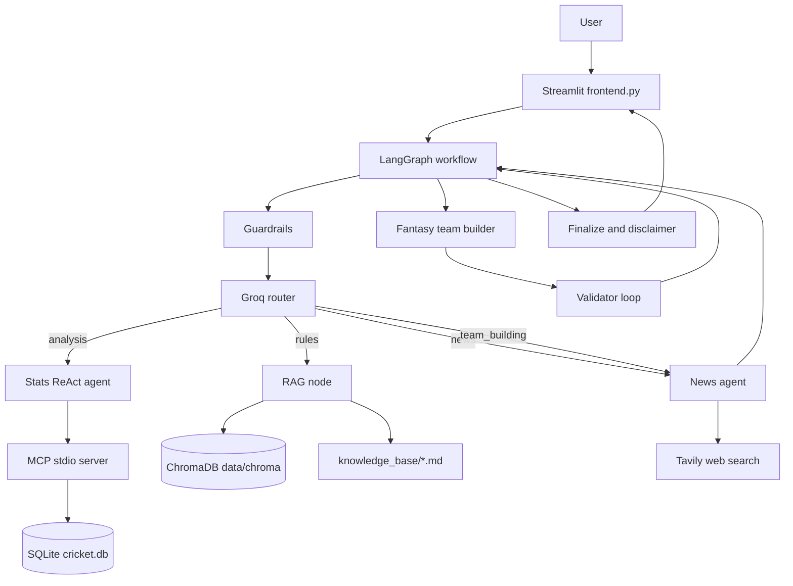

# Cricket Match Analyst: Architecture and Technology Guide

## 1. Project purpose

Cricket Match Analyst is a browser-based cricket analysis and fantasy-team
application. A user submits a natural-language question from the Streamlit
frontend. The application classifies the request, selects the appropriate data
source or tool, generates an answer with Groq, and displays the result.

Supported request categories include:

- Historical player, team, venue, and head-to-head statistics
- Cricket rules and fantasy-scoring explanations
- Current injuries, playing-XI updates, pitch reports, and weather
- Constraint-checked fantasy XI generation
- Betting and non-cricket scope guardrails

The project can run on the local synthetic dataset or on imported Cricsheet
ball-by-ball data.

## 2. High-level architecture



## 3. Request lifecycle

### 3.1 Frontend submission

[`frontend.py`](./frontend.py) provides the browser UI. It:

1. Loads `.env`.
2. Shows Groq configuration status.
3. Accepts a question.
4. Validates empty and clearly out-of-scope questions.
5. Creates the MCP client and LangGraph workflow.
6. Invokes the workflow asynchronously.
7. Renders the Markdown answer or a user-facing configuration error.

### 3.2 Routing

[`cricket_analyst/graph.py`](./cricket_analyst/graph.py) uses Groq structured
output to classify a question as:

- `analysis`
- `rules`
- `news`
- `team_building`
- `refuse`

The router also extracts team names, venue, and budget when relevant. Team
aliases such as `csk`, `mi`, and `rcb` are resolved against the loaded database.
Player names are handled separately so questions such as `Virat vs Rohit Sharma`
are treated as player comparisons rather than team comparisons.

### 3.3 Statistics path

For an analysis question:

1. Groq selects the statistics agent.
2. The agent calls MCP tools such as `player_stats`, `head_to_head`, and
   `venue_stats`.
3. The MCP server delegates to [`stats.py`](./cricket_analyst/stats.py).
4. `stats.py` executes parameterized SQLite queries.
5. Groq converts the returned data into a readable answer.

The model is instructed not to invent numerical statistics and to mention sample
size limitations.

### 3.4 Rules and knowledge path

For a rules question:

1. The RAG node reads the question.
2. ChromaDB searches vectorized chunks from [`knowledge_base/`](./knowledge_base/).
3. The most relevant excerpts are passed to Groq.
4. Groq writes an answer with source references.

The source documents are local Markdown files. ChromaDB is a local searchable
index, not a remote service or API account.

### 3.5 Current-news path

For a question involving current information:

1. The news agent builds targeted search queries.
2. Tavily searches the web.
3. Results are marked with age and freshness status.
4. Web content is labelled as untrusted data before it reaches Groq.
5. The answer includes uncertainty and source URLs where available.

Tavily is not used for historical statistics. It is used for current news,
injuries, playing-XI announcements, pitch reports, and weather.

### 3.6 Fantasy-team path

For a fantasy-team question:

1. Tavily searches current team news.
2. Confirmed unavailable players are excluded when they can be matched.
3. Statistics are loaded for the candidate pool.
4. Projections blend available historical, recent-form, and venue values.
5. The deterministic team builder selects a team.
6. The validator checks size, budget, role limits, and team caps.
7. The builder/validator loop repairs the selection until it is valid or reaches
   `MAX_BUILD_ITERS`.
8. The final response includes captain, vice-captain, credits, projections, and
   warnings.

## 4. Technology stack

| Technology | Used for | Why it is used |
|---|---|---|
| Python 3.12 | Application language | Mature ecosystem for data, AI, APIs, and automation |
| Streamlit | Browser frontend | Provides a simple interactive UI without a separate JavaScript build |
| LangGraph | Workflow orchestration | Models routing, branching, tool calls, loops, and finalization explicitly |
| LangChain Groq | LLM integration | Connects the workflow to the configured Groq chat model |
| Groq | Language understanding and answer generation | Classifies questions and turns retrieved data into natural-language answers |
| MCP | Tool boundary | Exposes statistics as typed callable tools to the analysis agent |
| SQLite | Structured cricket database | Fast local SQL queries for runs, wickets, venues, matches, and players |
| ChromaDB | Local vector database | Semantic retrieval from rules and knowledge documents |
| Tavily | Web search | Retrieves current cricket news and freshness-aware sources |
| pandas | CSV data loading | Normalizes Kaggle-style match and delivery files |
| Pydantic | Structured model output | Validates routing and news-extraction objects |
| python-dotenv | Configuration loading | Loads API keys and model settings from local `.env` |
| pytest | Automated tests | Verifies statistics, guardrails, projections, and team-builder behavior |

## 5. Data stores and files

| Path | Contents |
|---|---|
| [`data/cricket.db`](./data/cricket.db) | SQLite match and delivery data |
| [`data/players.csv`](./data/players.csv) | Fantasy player pool, roles, and credits |
| [`data/chroma/`](./data/chroma/) | ChromaDB vector index |
| [`data/cricsheet/json/`](./data/cricsheet/json/) | Downloaded Cricsheet JSON source files |
| [`knowledge_base/`](./knowledge_base/) | Rules and fantasy knowledge source documents |
| [`.env`](./.env) | Local secrets and runtime configuration; never commit it |

## 6. Real and synthetic data modes

### Synthetic mode

`python -m cricket_analyst.db --demo` creates fictional players, matches,
deliveries, and teams. It is safe for offline development but must not be
presented as real cricket history.

### Real-data mode

The project can import Cricsheet JSON archives using:

```text
python -m cricket_analyst.db --cricsheet-dir data\cricsheet\json
```

The current local database was imported from public Cricsheet T20, ODI, and Test
archives. Cricsheet naming and competition coverage can vary, so the answer
should be interpreted according to the loaded archive coverage.

## 7. Security and reliability boundaries

- API keys are loaded from `.env` and are never required in source code.
- `.env.example` contains placeholders only.
- Web results are treated as untrusted content, not instructions.
- Betting requests are refused.
- Non-cricket questions receive a scope message.
- Statistical numbers are expected to come from SQLite/MCP tools.
- Fantasy constraints are enforced in Python, not only in a prompt.
- News results include freshness warnings.
- The application displays provider/configuration errors without silently
  fabricating a result.

## 8. Main modules

| Module | Responsibility |
|---|---|
| [`frontend.py`](./frontend.py) | Streamlit user interface |
| [`cricket_analyst/graph.py`](./cricket_analyst/graph.py) | LangGraph nodes and routing |
| [`cricket_analyst/mcp_server.py`](./cricket_analyst/mcp_server.py) | MCP statistics tools |
| [`cricket_analyst/stats.py`](./cricket_analyst/stats.py) | SQLite statistics queries |
| [`cricket_analyst/db.py`](./cricket_analyst/db.py) | Database schema and importers |
| [`cricket_analyst/rag.py`](./cricket_analyst/rag.py) | ChromaDB ingestion and retrieval |
| [`cricket_analyst/news.py`](./cricket_analyst/news.py) | Tavily search and freshness handling |
| [`cricket_analyst/team_builder.py`](./cricket_analyst/team_builder.py) | Deterministic fantasy-team selection |
| [`cricket_analyst/guardrails.py`](./cricket_analyst/guardrails.py) | Scope, betting, and disclaimer rules |
| [`cricket_analyst/config.py`](./cricket_analyst/config.py) | Paths, model, and fantasy defaults |

