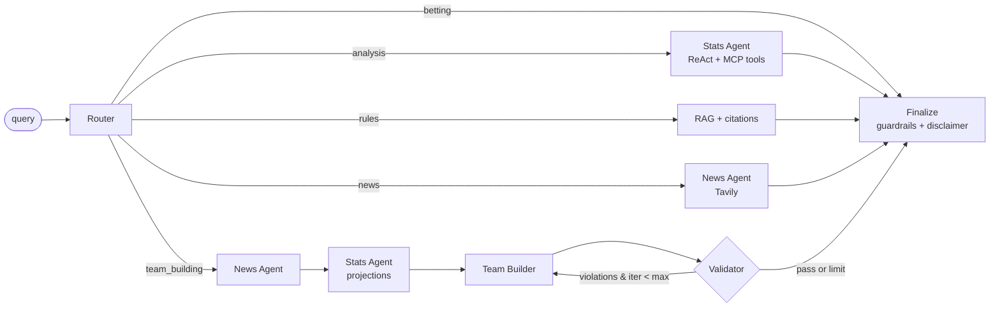

# Cricket Match Analyst & Fantasy Team Builder

Detailed documentation:

- [Architecture and technology guide](./ARCHITECTURE.md)
- [Command reference](./COMMANDS.md)

Agentic analyst (LangGraph + MCP + RAG + Tavily) for match analysis, rules Q&A, team news and
constraint-checked fantasy XIs.

## Architecture

| Piece | File |
|---|---|
| MCP tools `player_stats`, `head_to_head`, `venue_stats` | `mcp_server.py` (logic in `stats.py`) |
| Graph, router, agents, validator loop | `graph.py`, `team_builder.py` |
| RAG knowledge base (Chroma) | `rag.py`, `knowledge_base/` |
| Tavily news + 24h freshness check | `news.py`, `guardrails.py` |

A 4th route, `news`, handles questions like "who is likely to miss tonight's XI?" (the brief's sample query 4).

## Quick start
```bash
.venv\Scripts\python.exe -m pip install -r requirements.txt
copy .env.example .env                  # add GROQ_API_KEY and TAVILY_API_KEY
.venv\Scripts\python.exe -m cricket_analyst.db --cricsheet-dir data\cricsheet\json
.venv\Scripts\python.exe -m cricket_analyst.rag --ingest
.venv\Scripts\python.exe -m streamlit run frontend.py
```

## Frontend

The Streamlit frontend in [`frontend.py`](./frontend.py) lets you enter a question
in a browser, sends it through the existing LangGraph analyst, and renders the final
answer on the page.

Start it from the project root:

```text
python -m pip install -r requirements.txt
streamlit run frontend.py
```

The project is configured to use the fixed port `8501`. Open
`http://localhost:8501`.
Use the example questions in the sidebar or enter your own question. The frontend
does not duplicate the backend logic; it calls the same graph used by the CLI.
Live news and model-backed answers require the corresponding keys in `.env`. The
analyst uses Groq for model-backed answers.

If the frontend reports that the Groq API key is missing, create a local `.env`
file from the safe template and add your own key:

```text
copy .env.example .env
```

Edit `.env` so it contains:

```text
GROQ_API_KEY=your_real_key_here
CRICKET_MODEL=openai/gpt-oss-120b
```

Restart Streamlit after changing `.env`. Do not paste keys into source files or
commit `.env`.

If the frontend reports a provider billing or rate-limit error, authentication may
be working but the Groq account may have reached its limit. Check the Groq
console, then restart Streamlit. This is an account limitation, not an application
error.

### Frontend verification

`streamlit` was installed successfully in the project virtual environment and the
frontend was launched successfully at `http://localhost:8501`. Empty-question
validation was checked in the browser; it displays a warning instead of submitting
an invalid request. A complete analyst response still requires the backend
dependencies and model configuration described above.

**Real data:** for CSV sources, provide `matches.csv` + `deliveries.csv`, then run
`python -m cricket_analyst.db --matches matches.csv --deliveries deliveries.csv`.
For real multi-format data, download Cricsheet's JSON archives (Tests, ODIs,
T20Is, and other available competitions), extract them into one directory, then run:

```text
python -m cricket_analyst.db --cricsheet-dir data/cricsheet/json
```

The Cricsheet importer preserves real player names, teams, dates, formats, venues,
deliveries, runs, extras, wickets, tosses, and results. Player roles and fantasy
credits are not supplied consistently by Cricsheet, so imported players receive a
neutral `BAT`/8.0 fantasy placeholder in `players.csv`; use platform-specific
metadata before building fantasy teams. Cricsheet coverage varies by format and
competition, so responses identify the loaded database and coverage should be
checked before treating a statistic as comprehensive.

The current local database was populated from Cricsheet's public JSON archives for
T20, ODI, and Test matches. It contains 9,835 matches and 8,272 players. For
example, `Virat Kohli` resolves to Cricsheet's `V Kohli` name and can be queried
from the frontend. The source is public ball-by-ball data; it is not an official
or guaranteed-complete statistical record.
Put `data/players.csv` (`player,team,role,credits`, roles WK/BAT/AR/BOWL) together with credits from your fantasy platform,
using the same name style as the dataset (e.g. `V Kohli`; the resolver also maps `Virat Kohli`).
Optional `data/bowler_types.csv` (`bowler,type` = pace/spin) enables the pace/spin wicket split.

## Guardrails
- **No certainty:** prompts require probabilistic language; the footer disclaimer is appended to every non-refusal answer.
- **News >24h:** `assess_freshness` tags every result; undated items count as unverified; a warning is added when nothing is fresh, and when Tavily is not configured.
- **No real-money betting:** the Router refuses betting/wagering requests before any tool is called.
- **Prompt-injection:** web content is passed to the LLM as labelled untrusted data.
- **Constraints are code, not prompts:** `validate` enforces 11 players, credits, role limits and team cap. The loop stops at `MAX_BUILD_ITERS` and reports unmet constraints honestly.

## Tests
`pytest tests/` covers the stats layer, builder/validator convergence (20 random pools), projection blend,
freshness flags and the betting guardrail. These need no network or API keys.

### Synthetic demo coverage

The offline demo generator creates fictional data for all 10 IPL-style teams:
Chennai Super Kings, Mumbai Indians, Royal Challengers Bengaluru, Kolkata Knight
Riders, Delhi Capitals, Sunrisers Hyderabad, Rajasthan Royals, Punjab Kings,
Gujarat Titans, and Lucknow Super Giants. It generates 13 fictional players per
team, 60 synthetic matches across 2023-2025, deliveries, venue statistics, and
fantasy credits. Names and numbers are not real cricket data.

Regenerate it after changing the generator with:

```text
python -m cricket_analyst.db --demo
```

The generated pool supports aliases such as `csk`, `mi`, `rcb`, `kkr`, `dc`, `srh`,
`rr`, `pbks`, `gt`, and `lsg`.

### Supported questions

This application is intentionally a cricket analyst. It supports cricket rules,
match statistics, team news, and fantasy-team questions. Greetings and clearly
non-cricket questions, such as questions about a college, now receive a clear
scope message instead of being sent to the cricket backend.

## Known limits / next steps
- The rules in `knowledge_base/` are short starter summaries; add the official ICC Playing Conditions and IPL rules (`.md`/`.txt`).
- Fantasy scoring/constraints are Dream11-style defaults (`config.FantasyRules`); adjust per league.
- Projections are a simple blend of last-5, career and venue averages; extend with opposition, pitch and role/batting-order features.
- Optional: plot `fantasy.form_series` (returned by `player_stats`) as a form chart; swap the SQLite layer and knowledge base to add other sports.

## Setup and verification report

The project files were inspected, including the Python package, tests, knowledge base,
player data, dependency manifest, and environment template.

### Attempted setup

The documented setup commands were attempted without using any API credentials:

```text
python -m pip install -r requirements.txt
python -m cricket_analyst.db --demo
python -m cricket_analyst.rag --ingest
pytest tests/
python -m cricket_analyst.main "Build me a fantasy XI for CSK vs MI at Chepauk within 100 credits"
```

### Current environment result

Dependency installation was blocked by the execution environment before `pip` could
run. Because the dependencies are not installed, the follow-up commands could not
complete:

- Demo database: blocked by missing `pandas`.
- RAG ingestion: blocked by missing `chromadb`.
- Tests: blocked because `pytest` is unavailable.
- CLI application: blocked by missing `langchain_mcp_adapters`.

No database or Chroma runtime artifacts were generated during the attempt. To finish
setup in a normal Python environment, run:

```text
python -m pip install -r requirements.txt
python -m cricket_analyst.db --demo
python -m cricket_analyst.rag --ingest
pytest tests/
python -m cricket_analyst.main "How does umpire's call work in DRS?"
```

Configure real integrations by copying `.env.example` to `.env` and entering your
own `ANTHROPIC_API_KEY` and `TAVILY_API_KEY`. The repository template contains
placeholders only; credentials should never be committed.
